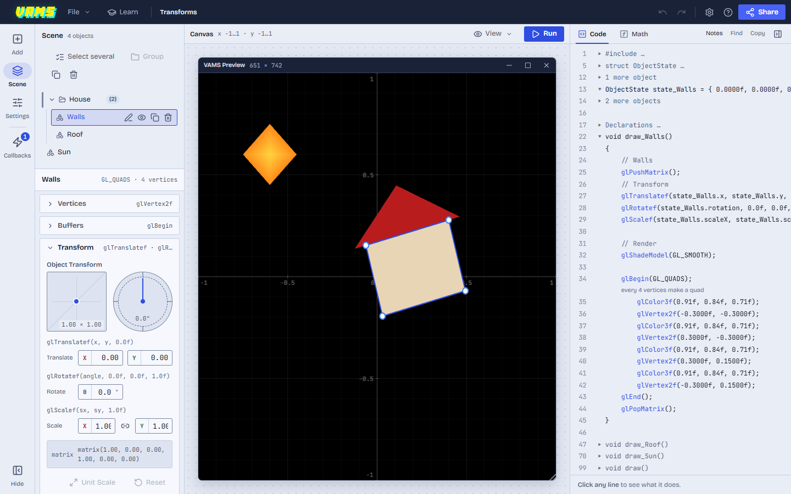
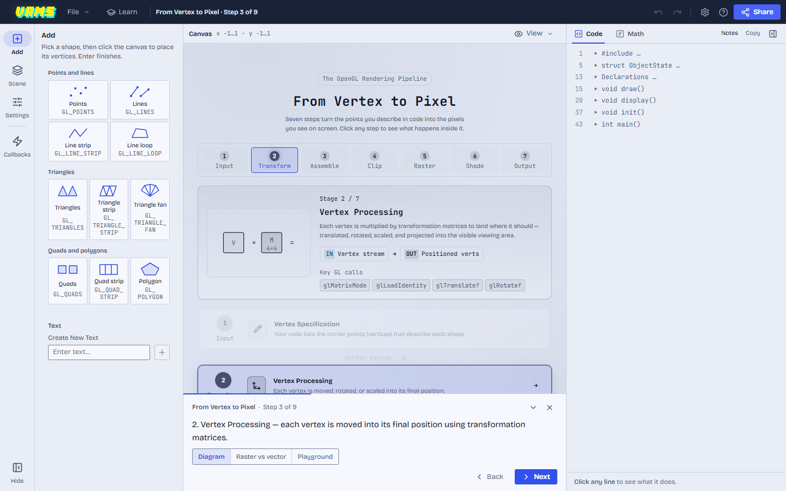
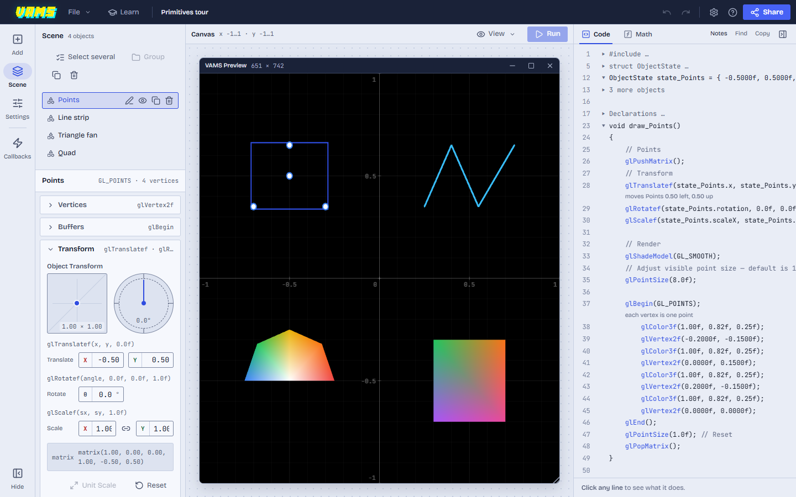
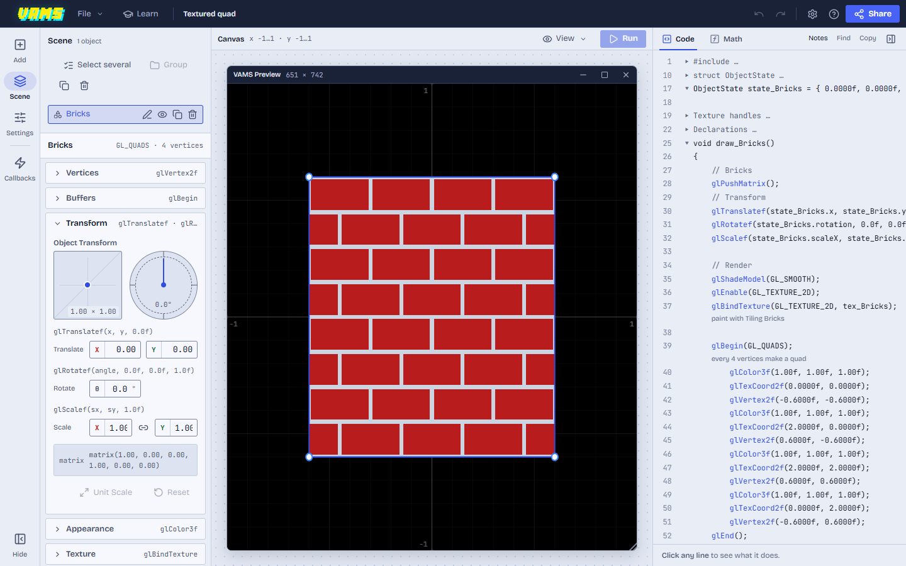
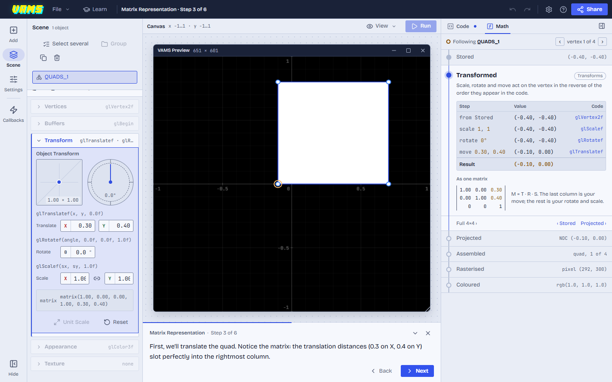
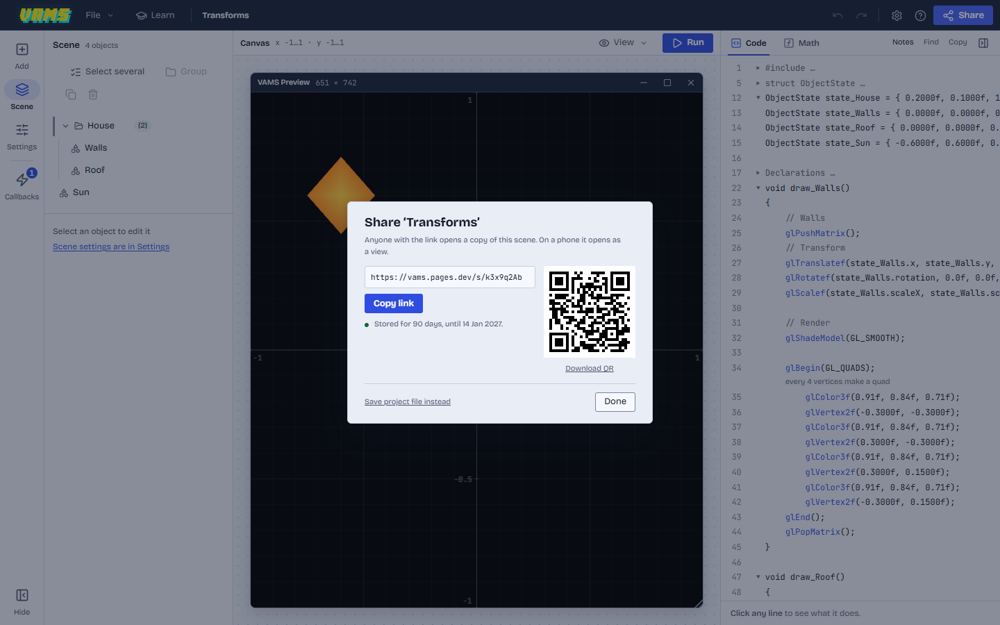

# VAMS — Visual Animation Modeling Simulator

**A GUI-only teaching simulator for OpenGL 1.5.**

Students build 2D scenes by hand and watch the C++ OpenGL program that draws
them write itself, line by line, with the math underneath.

[](https://github.com/mkepg/vams/actions/workflows/ci.yml)
[](LICENSE)


**[Try it live →](https://vams.pages.dev/)** · [Open the editor](https://vams.pages.dev/app) · [Browse the lessons](https://vams.pages.dev/learn)



---

## The problem

Students learning OpenGL 1.5 hit two walls at once. They have to reason about an invisible state machine — what is bound, what is on the matrix stack, what the current colour is — while also fighting a C++ toolchain that punishes every typo with a linker error. The graphics concept and the plumbing are tangled together, so a student who misunderstands `glOrtho` looks exactly like a student who forgot to link GLEW.

VAMS separates them. The student never writes code and never compiles anything. They manipulate a scene through a GUI, and VAMS keeps three views of it in step:

| View | What it shows |
| --- | --- |
| **Canvas** | The scene, drawn live inside a window like the one the real program would open. |
| **Code** | The read-only C++ OpenGL 1.5 program that would produce it. Click any line to see what it does. |
| **Math** | One vertex followed through the pipeline — stored, transformed, projected, assembled, rasterised, coloured — with the student's own numbers. |

Every change flows one way: student action → application state → all three views recompute. The views never write back. Because the code is *generated* from scene state rather than typed, it is always correct and always in sync, which makes it a reliable thing to read and learn from.

## What it does

VAMS follows the OpenGL pipeline in five curriculum sections. The editor's tools are the same in every section; the section is the student's place in the course.

**Pipeline** — a step-through diagram of the seven stages from vertex to pixel, a normalized-device-coordinate playground, a raster-versus-vector comparison, and the anatomy of a GLUT program.



**Primitives** — place all ten GL primitive types vertex by vertex, colour them with `glColor3f` or `glColor3ub`, style lines with width and stipple, and draw bitmap text.



**Buffers** — immediate mode, vertex arrays and VBOs, usage hints, indexed drawing and in-place updates, with GLEW-backed buffer code.

**Transforms** — translate, rotate and scale objects, group them into a hierarchy, and watch `T · R · S` build the matrix that moves every vertex. The viewing-volume editor makes `glOrtho` tangible.

**Textures** — attach images to geometry, edit UV rectangles directly, and see how `GL_LINEAR` versus `GL_NEAREST` and `GL_REPEAT` versus clamping change the result.



### Callbacks and Run

Students register GLUT callbacks — keyboard, special keys, mouse, motion, reshape and idle — and give each one rules built from menus, such as "the right arrow moves the house right". Each rule becomes real lines in the handler's body. **Run** then plays the program on the canvas: keys, clicks and drags go to the handlers, and the scene is restored when the program stops.

### Lessons and exercises

46 lessons — 25 demos and 21 exercises — are spread across the five sections and listed on the [Learn page](https://vams.pages.dev/learn), which remembers each student's progress. Lessons are authored as data and drive the scene through the same store actions the GUI uses, so every lesson step is something a student could also have done by hand. Exercises add a `successCheck`, a pure function over scene state that decides whether the student met the goal.



### Saving and sharing

- **Autosave and My scenes.** The working scene saves itself in the browser, and the My scenes library keeps named scenes and backups.
- **Files.** Save and open a project file, or export the generated program as a `.cpp` file.
- **Share.** Share gives a short link and a QR code. On a computer the link opens a copy of the scene in the editor; on a phone it opens a read-only view. Shared scenes are stored for 90 days.



### The site

Besides the editor at `/app`, the site has a home page, the Learn page and an About page. The pages are prerendered for search engines and link previews, and the app installs as an offline-capable PWA. The home page also has a stage mode for presenting it as slides.

## Quick start

Requires **Node.js 20+** and a browser with WebGL support.

```bash
git clone https://github.com/mkepg/vams.git
cd vams
npm install
npm run dev
```

Vite prints a local URL, usually <http://localhost:5173>.

| Script | What it does |
| --- | --- |
| `npm run dev` | Start the dev server with hot reload. |
| `npm run build` | Type-check with `tsc -b`, then build and prerender to `dist/`. |
| `npm run preview` | Serve the production build locally. |
| `npm run lint` | Run ESLint across the project. |
| `npm test` | Run the full Vitest suite once. |
| `npm run test:watch` | Re-run tests on change. |
| `npm run test:coverage` | Run tests and write a coverage report to `tests/reports/coverage/`. |
| `npm run test:visual` | Build, serve on port 4319, and compare Playwright screenshots against local baselines. |

The dev server does not run the share storage, so Share falls back to a longer link that carries the whole scene. To try stored links locally, build and serve with Cloudflare's tooling: `npm run build && npx wrangler pages dev dist`.

## Architecture

VAMS follows [Feature-Sliced Design](https://feature-sliced.design/). New code imports only from the layers below it, which keeps the 27 features independent of one another and makes each one readable on its own.

```
src/
├── app/        Entry points, routes and page metadata, prerendering, the PWA, global styles
├── pages/      home, learn, about, the editor, and the not-found page
├── widgets/    Composite UI: the canvas, the editor layout (top bar, rail, panels,
│               code and math column), the site header and footer
├── features/   27 self-contained capabilities — code-generation, lesson-engine,
│               callbacks, math-panel, share, textures, scene-library, …
├── entities/   Domain models: the scene (objects, viewport, interaction) and the project
├── core/       The Zustand store and its slices, shared types, callback and inspector models
└── shared/     The matrix engine, hooks, utilities, reusable UI controls, design tokens
functions/      Cloudflare Pages Functions that store and serve shared scenes
```

The pieces worth knowing about:

- **State** is a single [Zustand](https://zustand.docs.pmnd.rs/) store composed from slices (scene, viewport, interaction, history, lesson, runtime, callbacks, textures, settings and more), with [Immer](https://immerjs.github.io/immer/) for immutable updates and snapshot-throttled undo and redo. It persists to `localStorage`.
- **Code generation** (`features/code-generation`) is a pure function from scene state to a C++ source string, split into per-concern emitters for state, buffers, textures, callback handlers and render calls. Being pure is what makes it exhaustively testable.
- **Rendering** uses [PixiJS 8](https://pixijs.com/) on the canvas. The renderer draws the scene; it never owns it.
- **UI** is [Preact](https://preactjs.com/) with `preact/compat` aliased over React, so the React ecosystem works while the bundle stays small. Styles are SCSS on shared design tokens, with a light and a dark theme.
- **Sharing** compresses the scene with [fflate](https://github.com/101arrowz/fflate) and stores it through a Pages Function backed by Workers KV. The QR codes come from [uqr](https://github.com/unjs/uqr).

Written in TypeScript under `strict`, with `noUnusedLocals`, `noUnusedParameters` and `noFallthroughCasesInSwitch` all enabled.

## Hosting

The site runs on [Cloudflare Pages](https://pages.cloudflare.com/), built from `main` on every push. `wrangler.toml` binds the `SHARES` KV namespace that holds shared scenes, and `public/_redirects` sends `/s/<id>` links to the editor.

## Tests

1,024 tests across 51 files, all passing. The suite implements the verification programme in **Chapter 3, §3.10** of the manuscript, and each test carries a stable identifier of the form `{SUITE}-{MODULE}-{NN}` so results map back to the thesis tables.

| Suite | Files | Maps to | Covers |
| --- | --- | --- | --- |
| `tests/black-box/` | 32 | Table 12 | Behaviour through the public store API and the rendered UI — primitives, transforms, hierarchy, code generation, C++ validity, lessons, persistence, callbacks and Run, the site pages, sharing. |
| `tests/white-box/` | 16 | Table 13 | Internals — store slices, the matrix engine, scene-graph traversal, lesson internals, the callbacks runtime, the share payload and function, error handling. |
| `tests/algorithm/` | 3 | §3.10.3 | The three core algorithms, checked against independent reference implementations. |

```bash
npm test                 # run everything
npm run test:coverage    # regenerate tests/reports/coverage/
npm run test:visual      # screenshot checks (not part of npm test)
```

Algorithm validation deliberately avoids testing the implementation against itself: `tests/helpers/matrix.ts` is a separate reference implementation of the affine-matrix engine, used as the gold standard for ALG-1. Manual verification procedures that cannot be automated — compiling the exported C++, cross-browser checks — are written up in `tests/reports/`.

See [tests/README.md](tests/README.md) for the full suite breakdown.

## Documentation

- [docs/product-plan.md](docs/product-plan.md) — the authoritative product plan: what VAMS is, the core constraints, and the curriculum.
- [docs/specs/](docs/specs/) — design specs, one per project.
- [docs/plans/](docs/plans/) — the implementation plans that carried them out.
- [tests/README.md](tests/README.md) — test suite layout and identifier scheme.

## Academic context

This project is the software artifact of an undergraduate thesis.

- **Degree programme:** Bachelor of Science in Computer Science, with Specialization in Software Engineering
- **Institution:** FEU Institute of Technology
- **Adviser:** Elisa V. Malasaga
- **Academic year:** 2025–2026

**Authors**

- Gomez, Mikhael Edman P.
- Taguiam, Johann Patrick S.
- Vizco, Justine Jhigz D.

The thesis manuscript is not distributed in this repository.

## Status

Capstone project (CS0033 / CS0039, FEU Institute of Technology). All five curriculum sections are implemented, the lesson and exercise systems work end to end, and the evaluation study is complete. Work continues on the interface and the lesson content.

## License

Released under the [MIT License](LICENSE).
